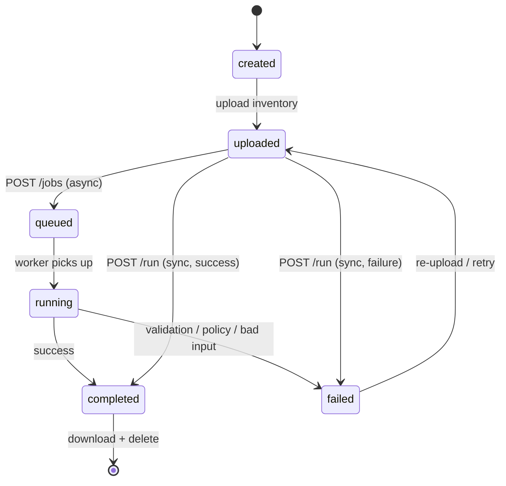
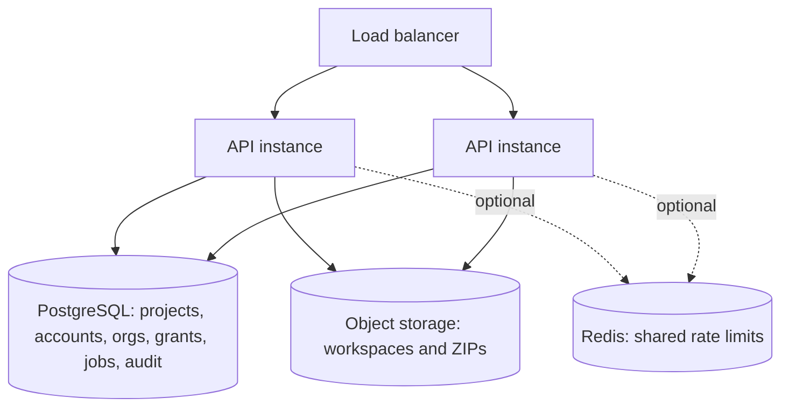

# IaCTranslate — Deployment & Execution

*Author and owner: Sai Kolanupaka*

Three things live here: **how a run executes** (the execution model), **how the
hosted service is deployed and operated**, as step-by-step procedures (MOPs),
and the **scale-out target**, with what of it is built and what isn't.

**Contents**
1. [Execution model (shipped)](#execution-model)
2. [Pipeline stages & trace (shipped)](#pipeline-stages)
3. [Project state machine (shipped)](#state-machine)
4. [Single-node deployment (shipped)](#single-node)
5. [The hosted deployment and its procedures (MOPs)](#the-hosted-deployment)
6. [Scale-out architecture (mostly built)](#reference-architecture)
7. [Multi-tenant model (built)](#multi-tenant)

---

## Execution model

What happens for one `POST /projects/{id}/run` (or one CLI `translate`):

```
Request
  ↓  a per-project temporary workspace is created (tempfile dir)
Pipeline  (parse → normalize → plan → validate → policy → package [→ zip])
  ↓  artifacts written into the workspace
Artifacts  (Terraform/Pulumi + reports + graph.json + trace)
  ↓  zipped on download
Response
  ↓  workspace evicted + deleted when the store exceeds its capacity cap
Cleanup
```

Bounds that make this safe on untrusted input (all env-overridable — see the
[Operations Guide §8](operations-guide.md#8-configuration-reference)):

- **Temporary workspace** per project (`tempfile.mkdtemp`), never a shared dir.
- **Memory/CPU** bounded by `IACTRANSLATE_MAX_VMS` (inventory size cap) and the
  25 MB streamed upload cap.
- **Store capacity** `IACTRANSLATE_MAX_PROJECTS` in single-tenant mode, where the
  oldest projects are evicted beyond it. Accounts have a quota instead
  (`IACTRANSLATE_MAX_PROJECTS_PER_ACCOUNT`) and are never evicted (ADR 0083).
- **No timeouts/retries needed today** — the pipeline is a synchronous, sub-second
  function (see [performance](operations-guide.md#14-performance)); timeouts and
  retries belong to the async reference architecture below.

## Pipeline stages

The pipeline runs as an ordered list of **named, timed stages**; each run emits a
`pipeline-trace.json` and a structured log line:

| Stage | Does |
|---|---|
| `parse` | source-specific → raw records |
| `normalize` | raw records → `NormalizedVM[]` |
| `plan` | classify · rightsize · network → `MigrationPlan` |
| `validate` | structural gate (catalog, CIDR, refs) |
| `policy` | organization rules (deny aborts, warn reports) |
| `package` | render + reports + graph + diagram |
| `zip` | archive (optional) |

```jsonc
// pipeline-trace.json
{ "total_ms": 38.4, "stages": [
    {"stage":"parse","duration_ms":9.0}, {"stage":"normalize","duration_ms":1.1},
    {"stage":"plan","duration_ms":1.4}, {"stage":"validate","duration_ms":0.1},
    {"stage":"policy","duration_ms":0.02}, {"stage":"package","duration_ms":26.7} ] }
```

This is the observability substrate. **Resumable / distributed** execution
(persist state after each stage, resume from the failed one, run stages on
workers) would build on this stage model — it needs the persistence + queue from
the reference architecture and is tracked in the [roadmap](roadmap.md), not yet
implemented.

## State machine

A project moves through explicit states (visible in the API and the web UI). The
**async** path (`POST /jobs`) adds `queued` → `running`; the **sync** path
(`POST /run`) goes straight to `completed`/`failed`:



The transitions are enforced by the API (`Project.status`); only a run/job
produces a downloadable project.

### Async jobs, events & audit (shipped, single-node)

The runtime layer is event-driven and job-based *today* — the interfaces the
production backends drop into:

- **Event bus** (`api/events.py`) — lifecycle events (`project.*`, `job.*`)
  published in-process; swap for Redis/Kafka without touching publishers.
- **Job queue** (`api/jobs.py`) — `POST /projects/{id}/jobs` → `job_id`; the
  pipeline runs on a worker thread; poll `GET /jobs/{id}`. Swap the
  `ThreadPoolExecutor` for Celery/Dramatiq + Redis behind the same contract.
- **Audit trail** (`api/audit.py`) — every action recorded via the bus; query
  `GET /audit`. In-memory now; the same subscriber writes Postgres in production.

**Not yet durable:** in-memory jobs/audit don't survive a restart — that comes
with the persistent backend below. See [ADR 0012](adr/0012-async-jobs-event-bus-audit.md).

## Single-node

The shipped deployment is a single container:

```
Docker (non-root, healthchecked /health)
  └─ uvicorn  →  FastAPI  →  in-memory ProjectStore + per-project temp workspaces
```

```bash
docker build -t iactranslate .
docker run -p 8000:8000 iactranslate
```

Good for a team, a demo, or CI. State is in-memory and workspaces are
temporary — restart loses projects (by design at this tier).

## The hosted deployment

iactranslate.com runs as three pieces, deployed separately:

| Piece | Where | Deployed with |
|---|---|---|
| API | Cloud Run service `iactranslate-api`, us-central1 | `scripts/deploy_api.sh <commit>` (MOP 1) |
| Console | Vercel project `iactranslate` → iactranslate.com | preview, check, promote (MOP 2) |
| Docs and investor overview | Vercel project `iactranslate-docs` → docs.iactranslate.com | automatic on every push to `main`: the repo-root `vercel.json` runs `scripts/build_public_site.py` (MOP 7) |

### How the API is configured

- **Scale:** up to 4 instances, 80 concurrent requests each, 1 vCPU and 1 GiB.
  CPU is allocated only while a request is being handled, so background work
  (notifications, emails) normally completes within the request that triggers
  it but can be delayed until the next request (ADR 0077).
- **Database:** Cloud SQL PostgreSQL 16 (`iactranslate-db`, db-f1-micro),
  reached on a private address only (ADR 0068). It allows 25 connections, 3 of
  them reserved. Each instance shares one pool of `IACTRANSLATE_DB_POOL_SIZE`
  (default 4), so 4 instances plus one starting during a deploy use at most
  20. Before that fix, five pools per instance could exhaust the database and
  stop new revisions from starting.
- **Backups:** the database is backed up daily from 08:00 UTC, the last 7 kept
  (on since 2026-11-24). Automated backups belong to the instance and can go
  with it if the instance is deleted, so deletion protection is on; deleting it
  first needs `gcloud sql instances patch iactranslate-db --no-deletion-protection`.
- **Files:** project workspaces live in a Cloud Storage bucket mounted at
  `/workspaces` (`IACTRANSLATE_WORKSPACE_ROOT`), so downloads survive restarts.
- **Accounts:** multi-tenant (`IACTRANSLATE_AUTH=session`); the console calls
  the API through Vercel's `/api` rewrite, so cookies are first-party
  (`IACTRANSLATE_COOKIE_SAMESITE=lax`).
- **Secrets,** each in Secret Manager and readable only by the service
  account `iactranslate-api@…`:

  | Secret | Becomes | Used for |
  |---|---|---|
  | `iactranslate-database-url` | `IACTRANSLATE_DATABASE_URL` | PostgreSQL |
  | `iactranslate-encryption-key` | `IACTRANSLATE_ENCRYPTION_KEY` | uploads encrypted at rest (ADR 0043) |
  | `iactranslate-slack-webhook` | `IACTRANSLATE_NOTIFY_SLACK_WEBHOOK` | run notifications (ADR 0077) |
  | `iactranslate-smtp-password` | `IACTRANSLATE_SMTP_PASSWORD` | Gmail App Password for account email (ADR 0078) |
  | `iactranslate-oidc-client-secret` | `IACTRANSLATE_OIDC_CLIENT_SECRET` | OIDC sign-in (ADR 0082) |

- **Mail:** Gmail over STARTTLS (`smtp.gmail.com:587`), signed in as the
  owner's Gmail address, which is also `IACTRANSLATE_RESET_EMAIL_FROM`. Sends
  reset, verification and invitation emails. Notification email is off (no
  `IACTRANSLATE_NOTIFY_EMAIL_TO`); notifications go to Slack.
- **OIDC:** on since 2026-11-24 with Google as the provider, whose app is in
  Testing, so only its listed test users can finish signing in. The client
  secret is `iactranslate-oidc-client-secret`.
- **Off on purpose:** SAML (no customer IdP yet; it is in the image), and
  `IACTRANSLATE_REQUIRE_VERIFIED_EMAIL` (the verification banner is a nudge).

A deploy changes only the image, so all of the above carries over.

### MOP 1 — Deploy the API

1. Push to `main` and wait for CI to pass. The image exists only if every job
   passed: `ghcr.io/kolanupaka92/iactranslate:<commit>`, scanned and signed.
2. Run `scripts/deploy_api.sh <commit>`; a short SHA is fine. It copies that
   image into Artifact Registry, deploys it as a new revision, checks
   `/health`, and prints the previous revision for rollback.
3. Check the new revision logged no errors:
   `gcloud logging read 'resource.labels.revision_name="<revision>" AND severity>=ERROR' --freshness 15m`.
4. If the release adds a migration (a new table or column), it runs on
   startup; CI's PostgreSQL job has already run it against a real database.

**Deploy the API before the console.** The console calls endpoints an older
API doesn't have.

### MOP 2 — Deploy the console

1. From `web/`: delete `web/.env.local` if `vercel link` wrote a
   `VERCEL_OIDC_TOKEN` into it, then run `vercel deploy --yes`. That makes a
   preview, not production.
2. Check the preview: the console loads, and the API calls the release depends
   on answer through `<preview>/api/v1/…`.
3. `vercel promote <preview-url> --yes`, then check iactranslate.com.

### MOP 3 — Roll back

- **API:** `gcloud run services update-traffic iactranslate-api --region us-central1 --to-revisions <previous>=100`.
  `deploy_api.sh` prints `<previous>`.
- **Console:** `vercel promote <previous deployment URL> --yes`, or roll back
  from the Vercel dashboard.
- A database migration is additive (new tables or columns only), so an older
  revision runs against a newer schema.

### MOP 4 — Add or rotate a secret

Secret values are handled by the owner only, never pasted into chat or a
commit.

1. Owner, in their own terminal (the value isn't echoed or kept in history):
   `read -rs V && printf '%s' "$V" | gcloud secrets create <name> --data-file=-; unset V`.
   To rotate an existing secret, use `gcloud secrets versions add <name>`
   instead of `create`.
2. Once, for a new secret: let the service account read it, with
   `gcloud secrets add-iam-policy-binding <name> --member=serviceAccount:iactranslate-api@<project>.iam.gserviceaccount.com --role=roles/secretmanager.secretAccessor`.
3. Point the service at it:
   `gcloud run services update iactranslate-api --region us-central1 --update-secrets <ENV_VAR>=<name>:latest`.
   A rotation also needs this step (or any new revision), because a revision
   reads `latest` when it starts.
4. Check the startup log (e.g. `notifications enabled: slack`) and exercise the
   feature once.

**Gmail App Password:** create it at myaccount.google.com/apppasswords
(2-Step Verification must be on), strip its spaces, then rotate
`iactranslate-smtp-password` with steps 1 and 3.
**Slack webhook:** make a new one in the Slack app's Incoming Webhooks page,
then rotate `iactranslate-slack-webhook` with steps 1 and 3.

### MOP 5 — Turn on single sign-on for a customer

**OIDC** (Okta, Entra ID, Google Workspace, Auth0…):

1. Register an app at the provider with redirect URI
   `https://iactranslate.com/api/v1/auth/sso/callback` (authorization-code
   flow, `openid email profile`).
2. Store the client secret (MOP 4) as `IACTRANSLATE_OIDC_CLIENT_SECRET`, and set
   `IACTRANSLATE_OIDC_ISSUER` and `IACTRANSLATE_OIDC_CLIENT_ID` with
   `--update-env-vars`.
3. Check `GET /api/v1/auth/methods` reports `"oidc": true`, then have someone
   sign in once. Refusals are logged as `sso callback rejected` with the reason.
   No `/auth/sso/callback` request at all means it stopped on the provider's
   pages: an account not allowed there, or a passkey the browser can't complete
   (sign in from an ordinary browser).
4. To turn it off: `--remove-env-vars IACTRANSLATE_OIDC_ISSUER,IACTRANSLATE_OIDC_CLIENT_ID
   --remove-secrets IACTRANSLATE_OIDC_CLIENT_SECRET`. The stored secret stays.

Use a Google Cloud project of its own for a Google client: the consent screen
(name, audience, publishing status) is shared by every client in a project.

**SAML:**


1. Get from the customer's IdP admin: the IdP entity ID, its HTTP-Redirect
   sign-in URL, its signing certificate (PEM), and the email domains it vouches
   for.
2. Give them this service's metadata:
   `https://iactranslate.com/api/v1/auth/saml/metadata` (entity ID and ACS URL).
3. Set `IACTRANSLATE_SAML_IDP_ENTITY_ID`, `_IDP_SSO_URL` and `_EMAIL_DOMAINS`
   with `--update-env-vars`, and the certificate as `IACTRANSLATE_SAML_IDP_CERT`.
   A certificate is public, so it can be an env var; Secret Manager works too.
4. Check `GET /api/v1/auth/methods` reports `"saml": true` and the sign-in
   screen shows "Continue with single sign-on". Then have someone from the
   customer sign in once. A refusal sends them back with a generic message,
   and the reason is in the log as `saml response rejected`.
5. During the IdP's key rotation, list both certificates in
   `IACTRANSLATE_SAML_IDP_CERT`.

### MOP 6 — Health and logs

- Liveness: `GET https://iactranslate-api-…run.app/health`. Counters:
  `GET /metrics` (Prometheus).
- Errors: `gcloud logging read 'resource.labels.service_name="iactranslate-api" AND severity>=ERROR' --freshness 1h`.
- Useful log lines: `notification to slack failed`,
  `password reset email to … failed`, `saml response rejected`,
  `sso claimed an unverified account`, `org invitation accepted`.
- Out of database connections ("remaining connection slots are reserved")
  means too many instances or too large a pool. Keep
  (max instances + 1) × `IACTRANSLATE_DB_POOL_SIZE` under 22, or move to a
  larger Cloud SQL tier.

### MOP 7 — Check the docs site deployed

Every push to `main` builds docs.iactranslate.com. Check that the newest
production deployment of `iactranslate-docs` is READY and that
`https://docs.iactranslate.com/` and `/overview` return 200. A 404 means the
build produced no site; `bash scripts/deploy_public_site.sh` deploys it by hand
while the build is fixed. Until this check existed, the site stayed on an
August build for three months because pushes "deployed" the raw repository.

### MOP 8 — Check and restore a database backup

Check, weekly: `gcloud sql backups list --instance iactranslate-db` shows a
SUCCESSFUL backup from the last 24 hours.

Restore into a **new** instance first. Restoring over the live one replaces
everything written since the backup.

1. Find the backup: `gcloud sql backups list --instance iactranslate-db`.
2. Create an empty instance with the same PostgreSQL version, region and private
   network, and at least the same disk size.
3. `gcloud sql backups restore <BACKUP_ID> --backup-instance=iactranslate-db --restore-instance=<new>`.
4. Check the data there, then either copy back what was lost, or store the new
   connection URL as a new version of `iactranslate-database-url` (MOP 4) and
   roll out a revision.
5. Delete whichever instance is no longer needed, once certain.

Project files aren't in these backups. They're in the workspaces bucket, where
deleted files can be recovered for 7 days. **This restore hasn't been rehearsed.**

## Reference architecture

How IaCTranslate runs with many users and large estates, and how much of it is
built:



- **Built:** stateless API instances behind a load balancer (Cloud Run); every
  durable store on PostgreSQL (ADR 0063); a durable job queue on the same
  database (ADR 0053); workspaces on object storage mounted as a file system
  (ADR 0029); optional Redis for rate limits shared across instances (ADR 0046).
- **Not built:** separate worker instances (the queue's workers run inside the
  API processes), checkpointed and resumable stages, and native object-storage
  APIs instead of a mounted bucket.

## Multi-tenant

Built (ADR 0027, 0050, 0080):

```
Organisation          owner / admin / member; invitations need consent and a proven address
  ├─ Users            password, OIDC or SAML sign-in; email verification
  ├─ Projects         personal or in an org; per-project roles on top
  ├─ Policies         policy engine, configured per project
  ├─ Artifacts        per-run outputs in the project's workspace
  └─ Audit            per-action log in PostgreSQL
```

Not built: teams within an organisation, per-org policy defaults, and per-org
data residency.
